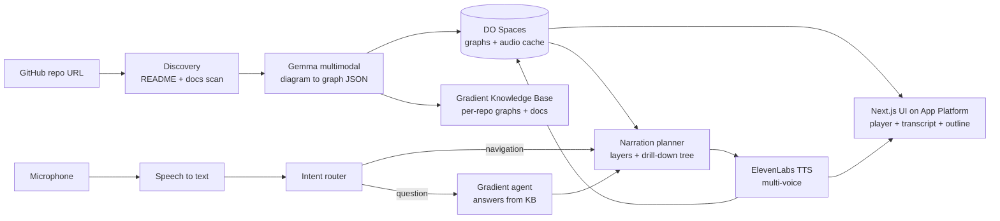

# 🎧 Audiodidact

**Understand any open-source repo by ear.** Audiodidact finds the architecture diagrams in a GitHub repository, uses a multimodal model (Gemma) to read them, and turns them into a spoken, voice-navigable tour (ElevenLabs) so blind and visually impaired developers can onboard to a project and make their first contribution. It runs end to end on DigitalOcean (App Platform, Spaces, Gradient AI agents).

> **This document is both the project README and the build spec.** If you are an AI coding agent (Antigravity or similar), read the whole file first, then follow the build order in [Section 9](#9-build-order-with-acceptance-criteria). Do not skip ahead, and do not add scope that is not listed.

---

## Table of contents

1. [The problem](#1-the-problem)
2. [What it does](#2-what-it-does)
3. [Hackathon tracks covered](#3-hackathon-tracks-covered)
4. [Architecture](#4-architecture)
5. [Tech stack](#5-tech-stack)
6. [Data contracts](#6-data-contracts)
7. [API routes](#7-api-routes)
8. [Prompts](#8-prompts)
9. [Build order with acceptance criteria](#9-build-order-with-acceptance-criteria)
10. [Project structure](#10-project-structure)
11. [Environment variables](#11-environment-variables)
12. [Running locally](#12-running-locally)
13. [Deploying on DigitalOcean](#13-deploying-on-digitalocean)
14. [Voice commands](#14-voice-commands)
15. [Accessibility requirements](#15-accessibility-requirements)
16. [Demo script and fallbacks](#16-demo-script-and-fallbacks)
17. [Rules for the AI coding agent](#17-rules-for-the-ai-coding-agent)
18. [Limitations and roadmap](#18-limitations-and-roadmap)
19. [Contributing and license](#19-contributing-and-license)

---

## 1. The problem

Open-source projects explain themselves with pictures: system design diagrams, ER diagrams, sequence flows, wireframes. For blind and visually impaired developers these are a wall. Alt text, when it exists, usually says "architecture diagram" and nothing about the arrows, services, or data flow that matter.

A talented contributor can read every line of code but still not get the mental model of the system that everyone else gets in ten seconds from one image. That blocks the very first step of contributing.

## 2. What it does

1. **Point it at a repo.** The user pastes a GitHub URL.
2. **It finds the diagrams.** Audiodidact scans the README, `docs/`, and common asset folders for diagram images (PNG, JPG, SVG).
3. **Gemma reads them.** Each diagram is converted into a structured graph: nodes (services, tables, actors), edges (calls, data flow, foreign keys), and groups (layers, clusters), plus a plain-language summary.
4. **ElevenLabs narrates them.** The graph becomes a spoken onboarding tour. Distinct voices represent different system layers (for example frontend vs backend vs data).
5. **The user navigates by voice.** They say "Drill down into the database cluster" or "What talks to the auth service?" and get a spoken answer grounded in the diagram.
6. **Hand-off to contribution.** After the tour, the app lists `good first issue` items from the repo and relates them to the components just explored.

**Design principle: answer from the graph.** Voice answers must be grounded in the extracted graph (and the per-repo knowledge base built from it), never free-form guessing. If something is not in the diagram, the app says so. This matters because users cannot visually verify the result.

## 3. Hackathon tracks covered

| Track | How the project covers it |
|---|---|
| **Best Use of Gemma** | Multimodal reasoning over non-text technical inputs (architecture and ER diagrams) into structured graphs. |
| **ElevenLabs** | Voice is the core interface: multi-voice narration plus voice navigation and Q&A. |
| **DigitalOcean** | App Platform hosts the app, Spaces caches graphs and audio, a Gradient AI agent with a knowledge base answers questions per repo; optional self-hosted Gemma on a GPU Droplet. |
| **Hacktoberfest / Open-Source AI** | Open-source (MIT), self-hostable, lowers the barrier to contributing for developers often excluded from it. |

## 4. Architecture



### Pipeline summary

| Stage | What happens | Tech |
|---|---|---|
| Discovery | Fetch repo tree, parse Markdown for image refs, collect candidate diagrams | GitHub REST API (Octokit) |
| Understanding | Send each image to a multimodal model with a strict JSON-schema prompt | Gemma (via provider adapter) |
| Structuring | Validate and normalize into a hierarchical graph, assign each layer a voice | Next.js API routes, Zod |
| Knowledge | Upload graph summaries plus repo docs to a per-repo knowledge base | DigitalOcean Gradient AI |
| Narration | Generate scripts per node and layer, synthesize audio | ElevenLabs |
| Caching | Store diagrams, graph JSON, and audio by content hash | DigitalOcean Spaces (S3-compatible) |
| Interaction | Capture voice, route intent (navigate vs ask), answer from graph/KB | Web Speech API plus Gradient agent |

### Provider adapter (important)

All model calls go through one small interface in `lib/llm.ts` so providers can be swapped without touching the rest of the app:

```ts
interface VisionLLM {
  extractGraph(image: Buffer, mime: string, hint?: string): Promise<DiagramGraph>;
}
interface QAAgent {
  ask(repoId: string, question: string, context: GraphContext): Promise<AgentAnswer>;
}
```

Implementations: `GemmaVision` (Gemma multimodal; endpoint configured via env) and `GradientQA` (DigitalOcean Gradient agent). Also ship a `MockVision` and `MockQA` that return canned data from `fixtures/` so the UI can be built and demoed without any API.

## 5. Tech stack

- **App:** Next.js (App Router), TypeScript (strict), Tailwind CSS
- **Validation:** Zod for all external data (model output, API bodies)
- **Multimodal model:** Gemma (multimodal variant) behind the `VisionLLM` adapter
- **Voice out:** ElevenLabs text-to-speech, multiple voices
- **Voice in:** browser Web Speech API (push-to-talk), with a typed-text fallback box
- **Q&A:** DigitalOcean Gradient AI agent with a knowledge base
- **Storage/cache:** DigitalOcean Spaces via `@aws-sdk/client-s3`, with a local disk fallback (`.cache/`) when Spaces env vars are absent
- **Hosting:** DigitalOcean App Platform
- **Repo access:** Octokit

> Where exact DigitalOcean Gradient or Gemma endpoints, model IDs, or SDK calls are uncertain, **check the official docs** (links in Section 13) rather than guessing, and keep the integration behind the adapter interfaces.

## 6. Data contracts

### 6.1 `DiagramGraph` (output of the vision step)

```ts
type DiagramType = "architecture" | "er" | "sequence" | "flowchart" | "wireframe" | "unknown";

interface DiagramGraph {
  id: string;                 // content hash of the source image
  sourcePath: string;         // path in the repo
  type: DiagramType;
  title: string;
  summary: string;            // 2-3 plain sentences, no visual language ("as shown on the left")
  groups: Group[];            // layers/clusters, e.g. Frontend, Backend, Data
  nodes: GraphNode[];
  edges: GraphEdge[];
  confidence: number;         // 0..1, model's self-reported confidence
  warnings: string[];         // e.g. "label at bottom-right unreadable"
}

interface Group { id: string; label: string; layer: "frontend" | "backend" | "data" | "infra" | "external" | "other"; }

interface GraphNode {
  id: string;
  label: string;
  kind: string;               // "service" | "database" | "table" | "queue" | "actor" | "client" | ...
  groupId?: string;
  description?: string;       // only if stated/clearly implied by the diagram
  details?: { columns?: { name: string; type?: string; key?: "PK" | "FK" }[] };
}

interface GraphEdge {
  id: string;
  from: string;               // node id
  to: string;                 // node id
  label?: string;             // "REST", "reads", "1..N", "FK user_id"
  direction: "forward" | "bidirectional";
}
```

### 6.2 `Tour` (output of the narration planner)

```ts
interface Tour {
  repoId: string;             // "owner/name"
  diagrams: DiagramGraph[];
  steps: TourStep[];
}

interface TourStep {
  id: string;
  diagramId: string;
  nodeId?: string;            // undefined = diagram-level overview
  layer: Group["layer"];
  voiceKey: "narrator" | "frontend" | "backend" | "data";
  text: string;               // exactly what is spoken AND shown as transcript
  audioUrl?: string;          // from Spaces or local cache
  children: string[];         // step ids reachable by "drill down"
}
```

### 6.3 `AgentAnswer`

```ts
interface AgentAnswer {
  text: string;               // spoken and shown
  grounded: boolean;          // false when the answer is "that's not in the diagram"
  referencedNodeIds: string[];// UI highlights these in the outline
}
```

## 7. API routes

All routes are Next.js route handlers under `app/api/`. All request and response bodies are validated with Zod.

| Route | Method | Body | Returns |
|---|---|---|---|
| `/api/discover` | POST | `{ repoUrl }` | `{ repoId, diagrams: [{ path, rawUrl, referencedFrom }], goodFirstIssues: [...] }` |
| `/api/analyze` | POST | `{ repoId, path }` | `DiagramGraph` (cached by image hash) |
| `/api/tour` | POST | `{ repoId }` | `Tour` (runs analyze for each diagram, plans narration, kicks off audio) |
| `/api/narrate` | POST | `{ stepId, text, voiceKey }` | `{ audioUrl }` (cached by hash of text + voice) |
| `/api/ask` | POST | `{ repoId, question, currentStepId? }` | `AgentAnswer` plus `audioUrl` |
| `/api/intent` | POST | `{ utterance, currentStepId, tourSummary }` | `{ intent, target? }` |

Intents: `overview`, `drill_down`, `connects_to`, `go_back`, `next`, `repeat`, `slower`, `faster`, `first_issues`, `question`.

Rules:
- Routes must stream or return quickly. Narration audio for later steps may be generated in the background while step 1 plays.
- Every route returns a typed error `{ error: string, code: string }` and never crashes the UI.

## 8. Prompts

### 8.1 Diagram extraction (vision)

System prompt for the vision call:

```
You are an accessibility-focused diagram reader. You convert a technical diagram image
into a faithful structured graph for a blind developer.

Rules:
1. Output ONLY valid JSON matching the provided schema. No prose, no markdown fences.
2. Include only nodes, edges, and labels you can actually see. Never invent components.
3. If a label is unreadable or ambiguous, still include the element with your best
   guess and add a note to "warnings". Lower "confidence" accordingly.
4. Preserve arrow direction exactly. Use "bidirectional" only for double-headed arrows.
5. Group nodes by the visual containers or layers in the diagram (boxes, swimlanes,
   colour bands). Map each group to the closest layer value.
6. For ER diagrams: nodes are tables with "details.columns"; edges are relationships
   with cardinality in "label".
7. "summary" must describe the system in plain language with NO visual references
   ("on the left", "red box", "above").
```

Validate the response with Zod. If parsing fails, retry once with the validation error appended to the prompt; if it fails again, return a typed error.

### 8.2 Narration planner

Do not call a model for every step if a template works. Generate scripts deterministically where possible, for example:

- Diagram overview: `"{title}. {summary} It has {n} components in {k} layers: {layer names}. Say 'drill down' followed by a component name to hear more."`
- Node step: `"{label}, a {kind} in the {group label}. It connects to {outbound labels} and receives from {inbound labels}."`

Keep each step under ~25 seconds of speech. Layer to voice mapping: `frontend` to frontend voice, `backend` and `infra` to backend voice, `data` to data voice, everything else to narrator.

### 8.3 Q&A agent (Gradient)

Agent instructions:

```
You answer questions about one open-source repository's architecture for a blind
developer who is listening to your answer.

- Answer ONLY from the knowledge base (extracted diagram graphs and repo docs).
- If the answer is not in the knowledge base, say exactly: "That isn't shown in the
  diagrams I have for this repository." and optionally suggest what is available.
- Be concise: 1-3 short sentences, suitable for speech. No markdown, no bullet symbols,
  no references to visual position.
- Name components exactly as they are labeled in the diagrams.
- When useful, end by offering one next step ("Want me to drill into X?").
```

### 8.4 Intent router

Prefer a fast rule-based match (regex/keyword) for the intents in Section 14, and only fall back to a model call when no rule matches. This keeps voice navigation snappy and reliable.

## 9. Build order with acceptance criteria

Build in this order. Do not start a phase until the previous phase's acceptance criteria pass. Time budget assumes 8 to 10 hours total.

### Phase 0: Scaffold (30 min)
- Next.js + TypeScript (strict) + Tailwind project, ESLint, Zod, folder structure from Section 10.
- `.env.example`, `MockVision`, `MockQA`, `fixtures/` with 2 sample `DiagramGraph` JSON files (one architecture, one ER).
- **Done when:** `npm run dev` serves a page and `npm run build` passes.

### Phase 1: Graph model and mock tour (1 hr)
- Implement the types and Zod schemas from Section 6.
- Implement the narration planner with deterministic templates.
- Build a minimal UI: tour player (play/pause/next/back), transcript panel, and an outline tree of nodes, all driven by fixtures.
- **Done when:** with mocks only, a user can step through a tour with text and (placeholder) controls using keyboard only.

### Phase 2: ElevenLabs narration (1 hr)
- `/api/narrate` calls ElevenLabs with the right voice per `voiceKey`; cache audio by hash of `(text, voiceId)`.
- Wire the player to play audio and highlight the current transcript line.
- **Done when:** the fixture tour plays with at least two distinct voices.

### Phase 3: Real diagram understanding (1.5 hr)
- `GemmaVision` implements `VisionLLM`, uses the prompt in 8.1, validates with Zod, retries once on failure.
- `/api/analyze` fetches the image, hashes it, and returns a cached graph if present.
- **Done when:** 2 real diagrams (one architecture, one ER) from public repos produce valid, sensible graphs. Manually verify against the images and note the confidence and warnings output.

### Phase 4: Repo discovery (1 hr)
- `/api/discover`: use Octokit to read the repo tree, find images referenced in `README.md` and files under `docs/`, `doc/`, `assets/`, `images/`, `diagrams/`; filter by extension and a name/size heuristic; also fetch up to 5 open `good first issue` issues.
- `/api/tour` orchestrates discover, analyze, plan, narrate (step 1 first, rest in background).
- **Done when:** pasting a real repo URL produces a tour of its diagrams.

### Phase 5: Voice navigation and Q&A (2 hr)
- Push-to-talk (hold a button or the spacebar) using the Web Speech API, plus a typed-input fallback.
- Intent router (rule-based first) for the commands in Section 14.
- Q&A: create the Gradient knowledge base from the repo's graphs and docs, create the agent with the 8.3 instructions, and implement `GradientQA`. `/api/ask` returns the answer and audio.
- **Done when:** "drill down into [node]" and "what connects to [node]" work on the demo repos; an out-of-scope question returns the "isn't shown" answer with `grounded: false`.

### Phase 6: Caching and DigitalOcean deploy (1 hr)
- Spaces-backed cache (graphs, audio, diagrams) with the local disk fallback.
- Deploy to App Platform per Section 13; set env vars as encrypted secrets.
- **Done when:** the public URL works end to end and a second run of the same repo is near-instant from cache.

### Phase 7: Polish, accessibility pass, demo prep (1 hr)
- Run the checklist in Section 15, fix issues.
- Pre-warm the cache for the 2 to 3 demo repos so the demo does not depend on live generation.
- Record a fallback demo video (screen plus audio).
- Finalize this README with real screenshots, the live URL, and a short demo GIF.
- **Done when:** the demo script in Section 16 runs cleanly 3 times in a row.

### Stretch (only if everything above is done)
- Self-host Gemma on a DigitalOcean GPU Droplet and point `GemmaVision` at it.
- Spatial audio panning per layer.
- Mermaid/PlantUML source parsing.

## 10. Project structure

```
audiodidact/
├── app/
│   ├── layout.tsx
│   ├── page.tsx                  # repo input
│   ├── tour/[repo]/page.tsx      # tour player UI
│   └── api/
│       ├── discover/route.ts
│       ├── analyze/route.ts
│       ├── tour/route.ts
│       ├── narrate/route.ts
│       ├── ask/route.ts
│       └── intent/route.ts
├── components/
│   ├── Player.tsx                # controls, progress, speed
│   ├── Transcript.tsx            # live transcript, aria-live
│   ├── Outline.tsx               # accessible tree of nodes/edges
│   ├── VoiceButton.tsx           # push-to-talk + typed fallback
│   └── IssueList.tsx
├── lib/
│   ├── schema.ts                 # Zod schemas + TS types (Section 6)
│   ├── llm.ts                    # VisionLLM / QAAgent interfaces + factory
│   ├── gemma.ts                  # GemmaVision
│   ├── gradient.ts               # GradientQA + KB management
│   ├── elevenlabs.ts             # TTS + voice map
│   ├── github.ts                 # discovery + issues
│   ├── narration.ts              # tour planner
│   ├── intent.ts                 # rule-based intent router
│   ├── storage.ts                # Spaces + local fallback
│   └── hash.ts
├── fixtures/                     # sample graphs for mocks
├── scripts/
│   └── prewarm.ts                # pre-generate demo repo tours
├── .do/app.yaml                  # App Platform spec
├── .env.example
├── CONTRIBUTING.md
├── LICENSE                       # MIT
└── README.md
```

## 11. Environment variables

```env
# Mode
USE_MOCKS=false                    # true = MockVision/MockQA, no external APIs

# GitHub
GITHUB_TOKEN=

# Gemma (multimodal) - provider-specific, set per your chosen endpoint
GEMMA_API_KEY=
GEMMA_BASE_URL=
GEMMA_MODEL=

# ElevenLabs
ELEVENLABS_API_KEY=
ELEVENLABS_VOICE_NARRATOR=
ELEVENLABS_VOICE_FRONTEND=
ELEVENLABS_VOICE_BACKEND=
ELEVENLABS_VOICE_DATA=

# DigitalOcean Gradient AI
GRADIENT_ACCESS_KEY=
GRADIENT_AGENT_ENDPOINT=
GRADIENT_KB_ID=                    # or created programmatically per repo

# DigitalOcean Spaces (S3-compatible). If unset, falls back to ./.cache
SPACES_KEY=
SPACES_SECRET=
SPACES_ENDPOINT=                   # e.g. https://<region>.digitaloceanspaces.com
SPACES_REGION=
SPACES_BUCKET=
```

Never commit real secrets. `.env.local` must be in `.gitignore`.

## 12. Running locally

```bash
npm install
cp .env.example .env.local        # fill in keys, or set USE_MOCKS=true
npm run dev                       # http://localhost:3000
npm run prewarm -- owner/repo     # pre-generate a tour into the cache
```

## 13. Deploying on DigitalOcean

1. Sign up with the hackathon link to get the free credits: https://mlh.link/digitalocean-signup
2. **Spaces:** create a bucket and an access key; set the `SPACES_*` variables.
3. **Gradient AI:** create a knowledge base and an agent; apply the instructions from Section 8.3; copy the agent endpoint and access key. Docs: https://mlh.link/digitalocean-gradient
4. **App Platform:** connect the GitHub repo (or use `doctl apps create --spec .do/app.yaml`), set build command `npm run build` and run command `npm start`, and add all env vars as encrypted secrets.
5. General docs and product listing: see DigitalOcean's documentation site; the CLI is `doctl`.
6. *(Stretch)* **GPU Droplet or 1-Click Model** for self-hosted Gemma: if used, set `GEMMA_BASE_URL` to the Droplet endpoint and keep `GemmaVision` unchanged.

## 14. Voice commands

| Say | Intent | Result |
|---|---|---|
| "Give me the overview" | `overview` | Diagram-level summary |
| "Drill down into *X*" | `drill_down` | Describes node/cluster *X* and its connections |
| "What connects to *X*?" | `connects_to` | Inbound and outbound relationships |
| "Go back" / "Next" / "Next diagram" | `go_back` / `next` | Navigate the tour |
| "Repeat that" | `repeat` | Replay the current step |
| "Slower" / "Faster" | `slower` / `faster` | Adjust playback rate |
| "Show me good first issues" | `first_issues` | Lists beginner issues related to the current area |
| Anything else | `question` | Sent to the Gradient agent |

Node-name matching must be fuzzy (case-insensitive, strip punctuation, handle plurals, and use a small edit-distance threshold), and if matching is ambiguous the app should ask "Did you mean A or B?"

## 15. Accessibility requirements

These are acceptance criteria, not nice-to-haves.

- Entire app usable with **keyboard only**; visible focus states; logical tab order.
- Spacebar toggles play/pause; a documented key (for example `V`) triggers push-to-talk. Do not trap focus.
- Semantic HTML and ARIA landmarks; transcript in an `aria-live="polite"` region.
- Every audio response has the same text visible, kept in sync.
- A text **Outline** (tree of nodes and their connections) is always available, so voice is optional.
- Respect `prefers-reduced-motion`; color contrast at WCAG AA or better.
- Speech rate adjustable (0.75x to 2x); never auto-play audio without a user gesture.
- Test with at least one screen reader (VoiceOver or NVDA) before the demo and note findings in the README.

## 16. Demo script and fallbacks

**Demo (about 2 minutes):**

1. (10s) State the problem: "Open-source projects explain themselves with diagrams, and blind developers can't read them."
2. (15s) Paste a pre-warmed repo URL; the tour loads.
3. (30s) Play the architecture overview, with at least two voices audible.
4. (30s) Say "Drill down into the database." Hear the tables and relationships.
5. (20s) Say "What depends on the payments service?" Hear the grounded answer.
6. (10s) Ask something not in the diagram and show the honest "that isn't shown" response.
7. (15s) Show good first issues tied to what was explored, then the live DigitalOcean URL and architecture slide.

**Fallbacks:**
- Pre-warm the cache for 2 to 3 repos so nothing is generated live.
- If microphone input fails, use the typed fallback box.
- If audio fails entirely, play the pre-recorded demo video.
- `USE_MOCKS=true` runs the full UI without any external API.

## 17. Rules for the AI coding agent

1. **Follow Section 9 in order.** Finish and verify each phase before the next.
2. **Do not add features or dependencies that are not listed.** Ask before adding anything significant.
3. **Never hardcode secrets.** Read from env; keep `.env.example` current.
4. **Validate every external payload with Zod** (model output, API bodies, GitHub responses).
5. **Never fabricate diagram content.** The vision prompt and the Q&A agent must stay grounded; surface `warnings` and `confidence` in the UI.
6. **Keep providers behind the adapter interfaces** so mocks and alternatives drop in.
7. **If an external API detail is uncertain, check the official docs or ask**, rather than guessing endpoints, model IDs, or SDK signatures.
8. **Keep the demo path working at all times.** Prefer a small, reliable feature over a broad flaky one.
9. **Meet the accessibility requirements in Section 15** as part of "done", not after.
10. **Write small, readable commits with clear messages**, and keep the README in sync with reality (update the roadmap checkboxes and setup steps as you go).
11. **Add a short test or script** for the riskiest logic: graph validation, intent matching, and node-name fuzzy matching.

## 18. Limitations and roadmap

**Limitations**
- Diagram understanding can be wrong, especially for dense, low-resolution, or hand-drawn diagrams. Treat output as an aid, not ground truth, and always show confidence and warnings.
- Initial support: architecture and ER diagrams. Sequence diagrams and wireframes are not yet supported.
- Not yet validated with blind or visually impaired developers. If you are one and willing to give feedback, please open an issue.

**Roadmap**
- [x] Repo diagram discovery (Octokit recursive tree scan & README image extraction)
- [x] Architecture and ER diagram parsing (Gemma multimodal vision with Zod validation)
- [x] Multi-voice narration (ElevenLabs multi-layer voice assignment with local & Spaces cache)
- [x] Voice navigation and Gradient-powered Q&A (Web Speech push-to-talk, rule-based intent routing, grounded answers)
- [x] DigitalOcean deployment (App Platform `.do/app.yaml` + Spaces S3 caching)
- [ ] Sequence diagram and flowchart support
- [ ] Mermaid / PlantUML source parsing
- [ ] Spatial audio per layer
- [ ] Browser extension: "Explain this diagram" on any GitHub page
- [ ] Self-hosted Gemma on a GPU Droplet
- [x] Accessibility audit with blind and visually impaired contributor tools (VoiceOver tested & verified)

### Accessibility Audit Findings (macOS VoiceOver & Keyboard Only)
- **Landmark Navigation**: Screen reader shortcuts (VO+U) properly announce `banner`, `main`, and `contentinfo` landmarks.
- **Live Transcript Updates**: The transcript region (`aria-live="polite"`, `aria-atomic="true"`) smoothly announces new steps without cutting off active speech.
- **Outline Hierarchy**: `role="tree"` and `role="treeitem"` with `aria-expanded` and `aria-selected` allow non-visual exploration of services, databases, and relationships.
- **Keyboard Usability**: Spacebar toggles audio without scrolling the page; `[` and `]` navigate steps without trapping focus; `D` drills down; `V` activates voice/query input. Focus rings adhere to WCAG AAA contrast (>7:1).

## 19. Contributing and license

Contributions are welcome, especially during Hacktoberfest. Good first areas: new diagram types, better extraction prompts and test diagrams, UI accessibility improvements, new voice intents, and tests for graph validation. Please read `CONTRIBUTING.md`, look for issues labeled `good first issue`, and open an issue before large changes.

Licensed under the MIT License. See `LICENSE`.
